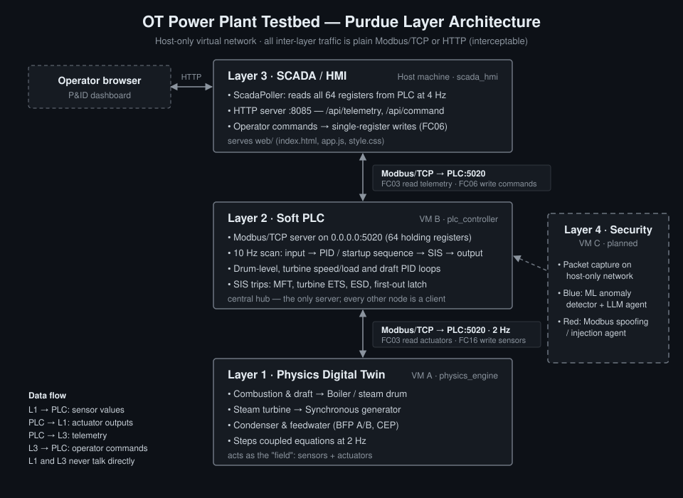

# OT Power Plant Security Testbed

A small Operational Technology (OT) testbed that simulates a 500 MW steam power plant, split across the levels of the **Purdue model**. Each layer is a separate C++17 program, and they talk over plain **Modbus/TCP**, so you can capture, study and later attack or defend the traffic between them.



## How it works

**Layer 1: Physics Digital Twin** (`physics_engine`) plays the physical plant. It models combustion and draft, the boiler and steam drum, the steam turbine, the generator, and the condenser/feedwater loop as coupled equations, stepping them twice a second. On every tick it reads the actuator registers from the PLC (fuel rate, valve positions, pump speeds, breaker), computes the new plant state, and writes the sensor values (pressures, temperatures, RPM, MW, …) back into the PLC.

**Layer 2: Soft PLC** (`plc_controller`) is the hub of the system and the **only server**. It holds 64 Modbus holding registers (`common/PlantRegisters.hpp`) and runs a 10 Hz scan cycle: read inputs → run the startup sequence and PID loops (drum level, turbine speed/load, furnace draft) → evaluate the safety system (Master Fuel Trip, turbine trip, ESD, first-out latch) → write outputs. Layer 1 and Layer 3 both connect to it as Modbus clients on port **5020**.

**Layer 3: SCADA / HMI** (`scada_hmi`) is the operator workstation. A background poller reads all 64 registers from the PLC 4 times a second. An embedded HTTP server (default port **8085**) serves the web dashboard in `Layer_3/web/` and exposes `/api/telemetry` and `/api/command`. Operator actions such as MW target, drum level setpoint, breaker, ESD and reset become single-register Modbus writes to the PLC.

**How they are connected:** Layer 1 and Layer 3 **never talk to each other directly**; every value goes through the PLC's registers. So if Layer 1 stops, the HMI keeps showing the last known values (it looks normal but is frozen). If the PLC stops, both other layers lose their only link and keep retrying until it comes back. **Layer 4** (security node with packet capture, an ML anomaly detector, and Red/Blue AI agents) is planned and not built yet.

## Directory structure

Each `.hpp` in `include/` has a matching `.cpp` in `src/`. Files marked *(legacy)* come from an older C version of the physics engine; they are not part of the build.

```
OT-security/
├── common/                    Shared headers used by all layers
│   ├── PlantRegisters.hpp     64-register Modbus map, alarm bits, trip codes
│   ├── ModbusProtocol.hpp     Minimal Modbus/TCP client + frame encoding
│   └── SocketUtils.hpp        Cross-platform socket wrappers (WinSock / POSIX)
├── Layer_1/                   Physics digital twin
│   ├── include/  src/         *System.cpp models + DigitalTwinPlant + main.cpp
│   └── Makefile  CMakeLists.txt
├── Layer_2/                   Soft PLC
│   ├── include/  src/         ModbusTcpServer, PlcDataBank, PlcScanEngine,
│   │                          PlcSafetyInterlocks, PidController
│   └── Makefile  CMakeLists.txt
├── Layer_3/                   SCADA / HMI
│   ├── include/  src/         ScadaPoller, HttpScadaServer, main.cpp
│   ├── web/                   index.html, app.js, style.css (dashboard)
│   └── Makefile  CMakeLists.txt
├── docs/architecture.svg      Diagram above
├── build_all.bat / .sh        Build all three layers (Windows / Linux)
├── run_all.bat                Start all three layers locally (Windows)
├── test_system.py             End-to-end smoke test (Modbus + HTTP)
└── CMakeLists.txt             Root CMake project
```

## Requirements

- `g++` with C++17 support and `make` (MinGW-w64 on Windows, `build-essential` on Linux). CMake is optional.
- Clone the **whole repository** on each machine, because every layer includes headers from `../common`.

## Option A: Run everything on one machine

Good for development and testing. All traffic goes over `127.0.0.1`.

**Windows**

```powershell
.\build_all.bat
.\run_all.bat
```

`run_all.bat` opens three windows (PLC first, then physics, then HMI). Open **http://localhost:8085** in a browser.

**Linux**: build once, then use three terminals and start them in this order:

```bash
./build_all.sh
cd Layer_2 && ./plc_controller 0.0.0.0 5020 100            # terminal 1: PLC
cd Layer_1 && ./physics_engine 127.0.0.1 5020 500          # terminal 2: physics
cd Layer_3 && ./scada_hmi 127.0.0.1 5020 8085 web          # terminal 3: HMI
```

## Option B: Run across VMs

This is the real deployment. Each layer runs on its own machine, so the traffic between layers actually crosses the network and can be sniffed.

| Machine | Runs | Connects to |
|---|---|---|
| VM B | Layer 2 (PLC) | listens on `0.0.0.0:5020` |
| VM A | Layer 1 (physics) | `<PLC_IP>:5020` |
| Host | Layer 3 (HMI) | `<PLC_IP>:5020`, serves `:8085` |

**1. Network.** Give every VM a **Host-only** adapter (VMware: VMnet1, VirtualBox: Host-Only Adapter), plus an optional NAT adapter for internet. Find each IP with `ip -br a` (Linux) or `ipconfig` (Windows), and make sure every machine can `ping` every other one.

**2. Install tools on both VMs.**

```bash
sudo apt update && sudo apt install -y build-essential cmake dos2unix
```

If `make` fails strangely after copying files from Windows, fix the line endings with `find . -name Makefile -o -name "*.sh" | xargs dos2unix`.

**3. Start the PLC first (VM B).**

```bash
cd OT-security/Layer_2 && make
./plc_controller 0.0.0.0 5020 100
```

Bind to `0.0.0.0` so the other machines can reach it. If you use `ufw`, open the port with `sudo ufw allow 5020/tcp`.

**4. Start the physics engine (VM A).**

```bash
cd OT-security/Layer_1 && make
./physics_engine <PLC_IP> 5020 500
```

**5. Start the HMI (Host, from inside `Layer_3`).**

```powershell
cd OT-security\Layer_3
mingw32-make
.\scada_hmi.exe <PLC_IP> 5020 8085 web
```

Open the URL it prints. If 8085 is busy it falls back to the next free port, so read the printed line.

**6. Verify the pipeline.** Gauges should move every second. Stop Layer 1 and the values freeze, start it again and they resume. Stop Layer 2 and the HMI shows disconnected.

## Command-line arguments

| Program | Arguments (defaults) |
|---|---|
| `plc_controller` | `[bind_ip=0.0.0.0] [port=5020] [scan_ms=100]` |
| `physics_engine` | `[plc_ip=127.0.0.1] [port=5020] [tick_ms=500]` |
| `scada_hmi` | `[plc_ip=127.0.0.1] [plc_port=5020] [http_port=8085] [web_dir=web]` |
